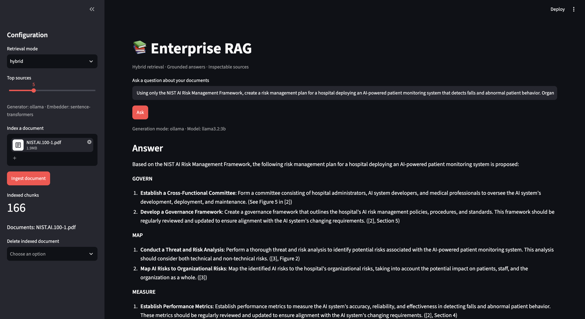
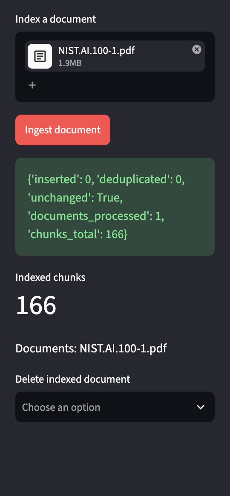
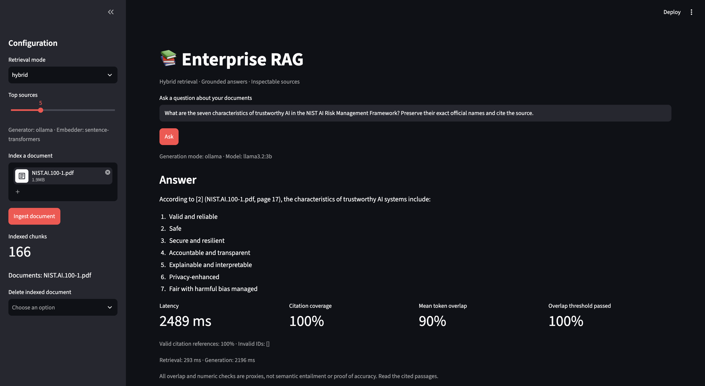
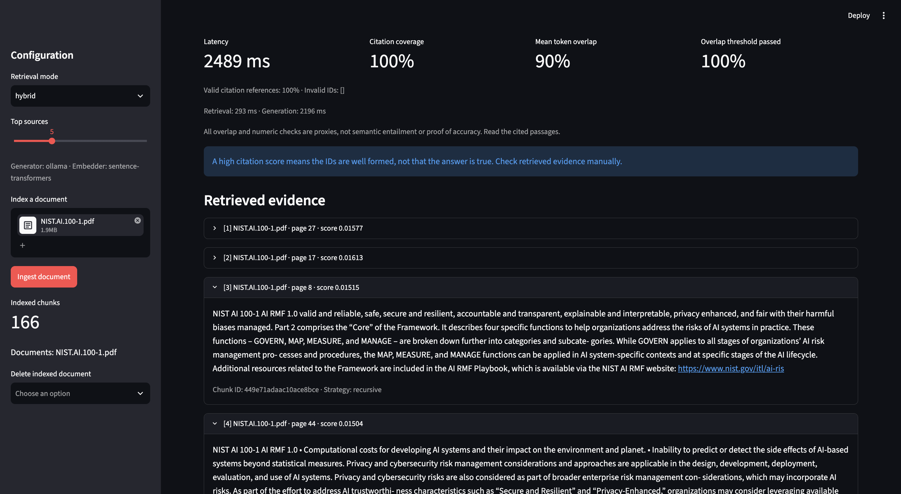
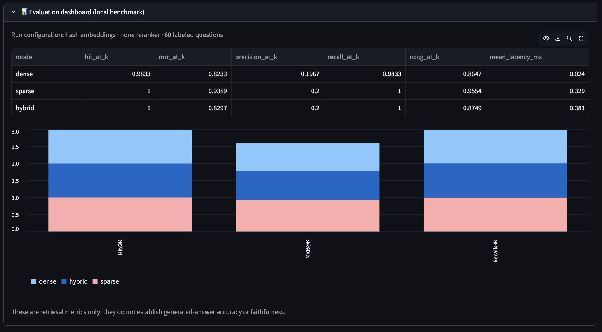
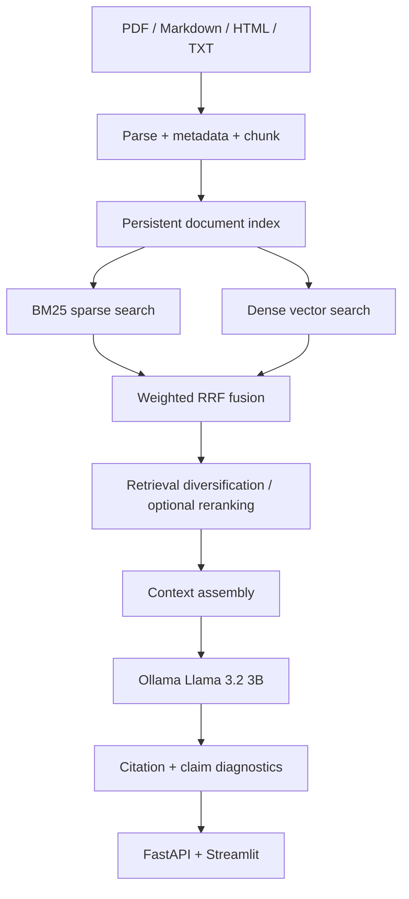
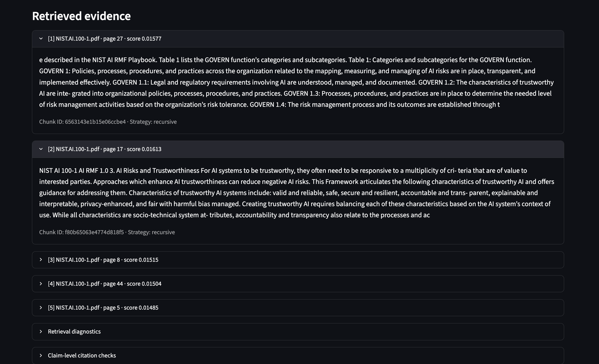
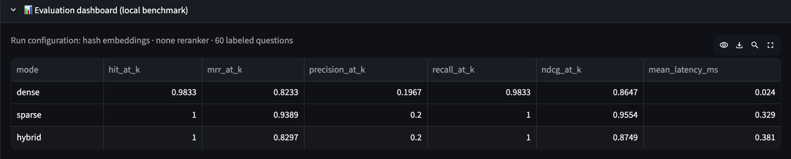

# Enterprise RAG — Hybrid Search & Evidence-Grounded Q&A

**Final portfolio release · V5**  
*Local-first document intelligence with semantic search, BM25, Ollama, source citations, and transparent evaluation.*

[](https://www.python.org/) [](https://fastapi.tiangolo.com/) [](https://streamlit.io/) [](https://ollama.com/) [](LICENSE)

Enterprise RAG is a **single-user, local-first retrieval-augmented generation (RAG) application** for asking questions over PDFs, Markdown, HTML, and plain-text documents. It combines **dense retrieval with keyword search**, produces responses using a locally hosted language model, and lets users examine the retrieved passages and citation diagnostics rather than blindly trusting the answer.

The project evolved through **five iterations**, with each version driven by implementation lessons, automated checks, and real-document testing using the **NIST AI Risk Management Framework**.

> **Project status:** GitHub portfolio release, **not** a production-certified enterprise service. The local AI model used for hands-on testing is **Llama 3.2 3B** via Ollama. Valid citation IDs and high lexical overlap do **not** prove a claim is factually supported. Known failure cases and future work are documented below.

---

## Demo










**Suggested demo flow:** Upload the NIST AI RMF PDF → ask for the seven characteristics of trustworthy AI → inspect citation `[2]` and page provenance → open retrieval diagnostics → try an out-of-document question and observe an explicit abstention.

## Why I built this

A simple RAG demo can retrieve a paragraph and generate a plausible answer. That alone doesn't establish that the answer is **complete**, **well-sourced**, or **correct**. This project explores the engineering challenges behind those distinctions:

- Does **hybrid retrieval** outperform keyword-only or dense-only search on a given dataset?
- Can generated claims be linked to the **right document and page**?
- What happens when a source contains **numbered categories, nested requirements, or multi-section evidence**?
- Can the model **abstain** when the document doesn't contain the answer?
- How do we measure and document **failure cases**, not just successful demonstrations?

## Features

| Layer | Implemented capabilities |
|---|---|
| **Ingestion** | PDF, Markdown, HTML and TXT parsing; document metadata, chunking, deduplication, version-aware updates and deletion |
| **Chunking** | Fixed, recursive and semantic strategies |
| **Retrieval** | BM25 sparse search, dense retrieval, weighted reciprocal rank fusion, lightweight query diversification and optional reranking |
| **Embeddings** | Lightweight hash-vector baseline or real Sentence Transformers embeddings |
| **Generation** | Ollama with `llama3.2:3b`, bounded retrieved context, source-aware prompting; explicit extractive mode for model-free demos |
| **Evidence** | Source/page references, ranked passages, citation-ID checks, claim-level lexical diagnostics and numerical-consistency warnings |
| **Evaluation** | 60-question synthetic retrieval dataset, BM25/dense/hybrid comparison, NIST regression fixtures, pytest suite |
| **Application** | FastAPI backend, Streamlit dashboard, model-status diagnostics, retrieval/generation timing |
| **Operations** | Docker support, GitHub Actions, optional API key, local-only container port bindings and safer upload validation |

**Boundaries:** The checker uses heuristics, not a validated semantic-entailment judge. Lightweight retrieval diversification is not guaranteed section-complete retrieval; authentication is optional and does not provide multi-tenant isolation.

## Architecture



### Technology stack

`Python` · `FastAPI` · `Streamlit` · `Ollama` · `Llama 3.2 3B` · `Sentence Transformers` · `BM25` · `ChromaDB` (optional) · `PyMuPDF` · `pytest` · `Docker` · `GitHub Actions`

---

## Getting started (macOS / VS Code)

The project is designed to run locally; it was developed and tested with an **Apple Silicon Mac with 8 GB RAM** in mind. Python **3.12** is recommended.

### 1. Clone and set up

```bash
git clone https://github.com/mayureshmohnalkar22/enterprise-rag-hybrid-search.git
cd enterprise-rag-hybrid-search
python3.12 -m venv .venv
source .venv/bin/activate
python -m pip install --upgrade pip
python -m pip install -e '.[ml,dev]'
```

If `python3.12` is unavailable on macOS with Homebrew:

```bash
brew install python@3.12
$(brew --prefix python@3.12)/bin/python3.12 -m venv .venv
source .venv/bin/activate
```

### 2. Install and run Ollama

Install [Ollama](https://ollama.com/download), launch its application/service, and download the model:

```bash
ollama pull llama3.2:3b
ollama list
```

### 3. Start the API — Terminal 1

```bash
source .venv/bin/activate

# Local development only. Enable RAG_API_KEY for shared environments.
unset RAG_API_KEY

export RAG_EMBEDDER=sentence-transformers
export RAG_LLM=ollama
export RAG_OLLAMA_MODEL=llama3.2:3b
export RAG_RERANKER=lexical
export RAG_STORAGE=storage/semantic-v5

python -m scripts.seed
python -m uvicorn app.main:app --reload --host 127.0.0.1 --port 8000
```

### 4. Start the dashboard — Terminal 2

```bash
source .venv/bin/activate
export RAG_API_URL=http://127.0.0.1:8000
python -m streamlit run app/dashboard.py
```

- **Dashboard:** http://localhost:8501
- **API documentation:** http://127.0.0.1:8000/docs
- **Health check:** http://127.0.0.1:8000/health

The first run with Sentence Transformers may download an embedding model. On an 8 GB machine, keep `RAG_RERANKER=lexical` until you have measured memory usage with a cross-encoder.

### Lightweight mode (no downloaded LLM)

```bash
export RAG_EMBEDDER=hash
export RAG_LLM=extractive
export RAG_STORAGE=storage/demo-v5
python -m scripts.seed
python -m uvicorn app.main:app --reload
```

This is useful for smoke tests, but **hash embeddings and extractive answers are not equivalent to neural semantic RAG**. Use a separate storage directory whenever you switch embedding configurations.

## How to use it

1. Start FastAPI and Streamlit in separate terminals.
2. Upload a PDF, Markdown, HTML or TXT document in the dashboard.
3. Ask a question and inspect the answer's cited sources.
4. Review the retrieved passage scores, source locations and generation timing.
5. Compare search modes and run the benchmark scripts before drawing conclusions about retrieval quality.



---

## Evaluation and test results

### Automated tests

The corrected V5 package previously passed **32 automated tests** in the available test environment. The suite covers core pipeline behavior and selected ingestion, storage, security and regression cases. Run it on your own machine to verify your configuration:

```bash
python -m pytest -q
python -m scripts.validate_dataset
python -m scripts.check_nist_regressions
```

**A passing test suite does not mean the LLM answers are universally correct.** The NIST tests below explicitly demonstrate why.

### Retrieval benchmark — V4 measured baseline

The following is an **actual V4 baseline**, not a V5 neural-embedding result. It used **six small synthetic documents**, **12 recursive chunks**, **60 labeled questions**, `k=5`, and **hash embeddings**:

| Retrieval method | Recall@5 | MRR@5 | nDCG@5 |
|---|---:|---:|---:|
| Dense (hash baseline) | 0.9833 | 0.8233 | 0.8647 |
| BM25 | **1.0000** | **0.9389** | **0.9554** |
| Hybrid | 1.0000 | 0.8297 | 0.8749 |

**Finding:** BM25 ranked relevant documents higher on this small dataset. The result motivated configurable fusion weights and more transparent evaluations; it **does not** prove BM25 is universally better than hybrid retrieval. V5 settings differ from the V4 baseline.

Run the current V5 benchmark separately:

```bash
python -m scripts.benchmark_release --output reports/v5-retrieval.json
python -m scripts.benchmark_release \
  --embedder sentence-transformers \
  --output reports/v5-semantic.json
```


### Real-document testing — NIST AI RMF (V5 + Llama 3.2 3B)

Six questions were manually reviewed using the uploaded NIST AI Risk Management Framework PDF. These are **individual observed runs**, not repeated-trial averages or an accuracy benchmark.

| Test | Outcome | Finding |
|---|---|---|
| **1. Seven trustworthy-AI characteristics** | **Pass** | All seven preserved, including the compound names; 100% citation coverage, 90% mean token overlap; 8.71 s latency |
| **2. Detailed GOVERN / MAP / MEASURE / MANAGE** | **Partial** | All four covered, but MAP/MEASURE lacked substantive section evidence; 27% citation coverage; 26.52 s latency |
| **3. GOVERN 1 vs GOVERN 1.1** | **Fail** | Incorrectly attributed category definitions and conflated requirements; 40% citation coverage; 10.73 s latency |
| **4. Out-of-document NVIDIA revenue** | **Pass** | Correctly abstained rather than inventing a financial figure; 6.17 s latency |
| **5. MAP-specific evidence and activities** | **Partial** | Relevant MAP source found, but specific activities were mainly paraphrases of general objectives; 57% citation coverage; 15.35 s latency |
| **6. Hospital AI risk-management plan** | **Fail** | Structured plan, but incorrectly presented some inferred recommendations and HIPAA obligations as direct NIST requirements; 50% citation coverage; 20.27 s latency |

**Overall:** **2 pass · 2 partial · 2 fail** for these six manually assessed responses. This is not a statistical performance score.

**Important interpretation:** Citation coverage counts citation placement; citation-ID validity checks whether references exist. Neither establishes that cited evidence *entails* the claim. Lexical overlap is also only a proxy and may fail on paraphrases or structured documents. Correct abstentions can reasonably have no citations; a displayed 0% citation score does not necessarily signify a bad refusal.

These findings show what works, where it breaks, and why the remaining improvements matter.



---

## Evolution of the project — V1 to V5

The project was not built as a single one-off chatbot. It changed in response to working demos, failed assertions, document-grounding problems, and benchmark evidence.

### V1 — RAG foundation

**Goal:** Build a complete, runnable document question-answering application.

- Added PDF / HTML / Markdown / TXT ingestion, chunking and document indexing.
- Implemented initial dense retrieval, BM25 and hybrid fusion.
- Added an answer-generation interface, FastAPI API, and Streamlit dashboard.
- Added a starter evaluation dataset, tests, Docker and basic README.

**Lesson:** Basic ingestion and retrieval are only the foundation; meaningful evaluation is needed to understand answer reliability.

### V2 — Semantic retrieval and reproducible evaluation

**Goal:** Move beyond a simple demonstration and compare retrieval methods.

- Added optional Sentence Transformers embeddings and a dedicated semantic-search configuration.
- Added reproducible BM25-versus-dense-versus-hybrid benchmarks, ranking metrics and plots.
- Validated the 60-case synthetic dataset and expanded the documentation.
- Fixed a storage-configuration bug that caused API tests to reuse existing local data instead of isolated test storage.

**Lesson:** Retrieval results depend heavily on dataset characteristics; a combined search method is not automatically superior.

### V3 — Citation intelligence and source inspection

**Goal:** Make citations inspectable and expose what the model actually used.

- Added grouped-list-aware citation accounting and invalid citation-ID diagnostics.
- Exposed ranked retrieved passages and separate retrieval/generation timing.
- Added claim-level inspection and more focused NIST regression cases.
- Investigated a NIST answer that cited a valid page yet omitted one of seven official characteristics.

**Lesson:** Having a citation is not the same as providing a complete or supported answer.

### V4 — Verification transparency and reliability tests

**Goal:** Fix misleading evaluation signals from V3.

- Split the former lexical-support proxy into **mean token overlap** and **overlap threshold pass rate**.
- Added warnings for possible contradictory abstention, invalid references and number inconsistencies.
- Expanded regression coverage to 25 automated tests.
- Audited V4 retrieval on the synthetic corpus; BM25 outperformed hash-based hybrid on ranking quality.
- Identified false numeric warnings caused by page references/section metadata and an unhandled malformed-PDF case.

**Lesson:** Evaluation tools themselves need testing; a misleading metric can be as problematic as a bad answer.

### V5 — Final portfolio release

**Goal:** Consolidate the best working features, improve reliability and present reproducible evidence.

- Added configurable hybrid fusion weight and lightweight retrieval diversification.
- Improved numerical diagnostics so citation/page/section metadata are not treated as ordinary quantities.
- Added optional API-key protection, malformed-upload handling and localhost-bound Docker defaults.
- Added document deletion, persistent-data regression coverage and explicit model/configuration status.
- Expanded the corrected automated suite to **32 tests**, including isolation from exported shell model settings.
- Consolidated architecture, setup, security caveats, benchmarks and release history.
- Performed the six-question NIST field test that exposed remaining hierarchy and evidence-grounding gaps.

**Release positioning:** V5 is the **final numbered portfolio release**, with future work tracked as enhancements rather than pretending the current system is production-certified.

For further details, see [Version History](docs/VERSION_HISTORY.md), [Evaluation Methodology](docs/EVALUATION.md) and [Security Boundaries](docs/SECURITY.md).

---

## Current limitations

This release intentionally records its limitations rather than hiding them:

- **Hierarchical document structure:** Numbered table entries such as `GOVERN 1` and `GOVERN 1.1` can be confused when parsing or retrieving excerpts.
- **Multi-section coverage:** A top-K retriever can over-select one section and leave other requested sections underrepresented.
- **Citation faithfulness:** A valid citation may not support a generated claim; the current diagnostics are heuristic.
- **Model capability:** Llama 3.2 3B is affordable for local inference, but complex synthesis and policy interpretation can be inconsistent.
- **Evaluation size:** The synthetic retrieval benchmark is small and easy; the six real-document questions are useful case studies, not a held-out statistical evaluation.
- **Deployment:** The application is designed primarily for local single-user use, not secure multi-tenant production hosting.

## Future enhancements

These are **planned ideas, not implemented V5 features**.

| Priority | Enhancement | Why it matters |
|---|---|---|
| P0 | **Structure-aware PDF/table ingestion** | Preserve headings, table rows, category/subcategory IDs and page context |
| P0 | **Exact identifier + section-aware retrieval** | Improve numbered-policy queries and balanced evidence for multi-section questions |
| P0 | **Claim-to-citation entailment checks** | Test actual source support rather than citation formatting or word overlap |
| P0 | **Evidence-driven answer planning / revision** | Check required facts and revise unsupported or incomplete responses with bounded retries |
| P1 | **Abstention-aware metrics** | Show `N/A` rather than misleading zero citation/support scores for correct refusals |
| P1 | **More rigorous evaluation dataset** | Introduce harder, independently labeled retrieval and answer-faithfulness questions |
| P1 | **Optional stronger model comparison** | Compare Llama 3.2 3B with larger local/cloud models using the same questions and retrieval outputs |
| P1 | **Security hardening** | Add per-user/tenant document isolation, rate limiting, input threat tests and stronger authorization |
| P2 | **Performance optimization** | Cache embeddings, batch ingestion, assess quantized models and p50/p95 latency |
| P2 | **Operational observability** | Request traces, structured logs, resource monitoring and failure categories |

The immediate next engineering work would be **hierarchy-aware retrieval** and **claim-level evidence verification**, because those are the most serious failures observed in the NIST tests.

## API endpoints

| Method | Endpoint | Purpose |
|---|---|---|
| `GET` | `/health` | Backend health check |
| `GET` | `/v1/status` | Model / retrieval configuration status |
| `GET` | `/v1/documents` | List indexed sources |
| `POST` | `/v1/ingest` | Upload and index a document (API limit: 15 MiB) |
| `POST` | `/v1/ask` | Ask a question with a retrieval mode and `top_k` |
| `DELETE` | `/v1/documents/{source}` | Remove an indexed source |

Set `RAG_API_KEY` for optional `X-API-Key` protection when appropriate. Both backend and Streamlit need the same value if enabled. The upload widget may advertise a larger limit than the API actually accepts; the backend limit is authoritative.

## Repository layout

```text
enterprise-rag-hybrid-search/
├── app/                 # FastAPI backend + Streamlit dashboard
├── rag/                 # Ingestion, chunking, embeddings, retrieval, generation, verification
├── scripts/             # Seed, preflight, tests, retrieval benchmarks, NIST regressions
├── tests/               # Unit and integration test suite
├── data/                # Synthetic source documents and labeled evaluation questions
├── reports/             # Example evaluation outputs
├── docs/                # Evaluation, security, changelogs, screenshot guidance
│   └── screenshots/     # Add genuine application screenshots here
├── .github/workflows/   # CI checks
├── Dockerfile
├── docker-compose.yml
├── pyproject.toml
├── .env.example
└── README.md
```

## Acknowledgments and dataset notes

- [NIST AI Risk Management Framework (AI RMF 1.0)](https://nvlpubs.nist.gov/nistpubs/ai/NIST.AI.100-1.pdf) — real-document testing reference; not bundled as a private upload or claimed as training data.
- [Ollama](https://ollama.com/), [Sentence Transformers](https://www.sbert.net/), [FastAPI](https://fastapi.tiangolo.com/) and [Streamlit](https://streamlit.io/) — technologies used by the project.

## License

Distributed under the **MIT License**. See [LICENSE](LICENSE).
